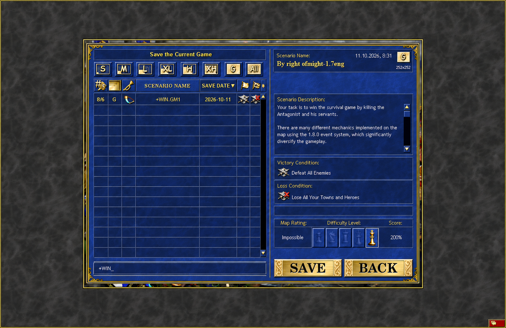

# `hip-0002` - Sort games on save date

> **Category:** Main menu UI

Add a sortable **Save Date** column to the **Load Game** and **Save Game** screens. Display each date using the `YYYY-MM-DD` format. Expand the dialog proportionally to accommodate the column without compressing or distorting the existing content.

> **Author:** Alexander Cyon · **Date:** 2026-10-10 · **Status:** **DRAFT** · **Estimate:** **Average**
