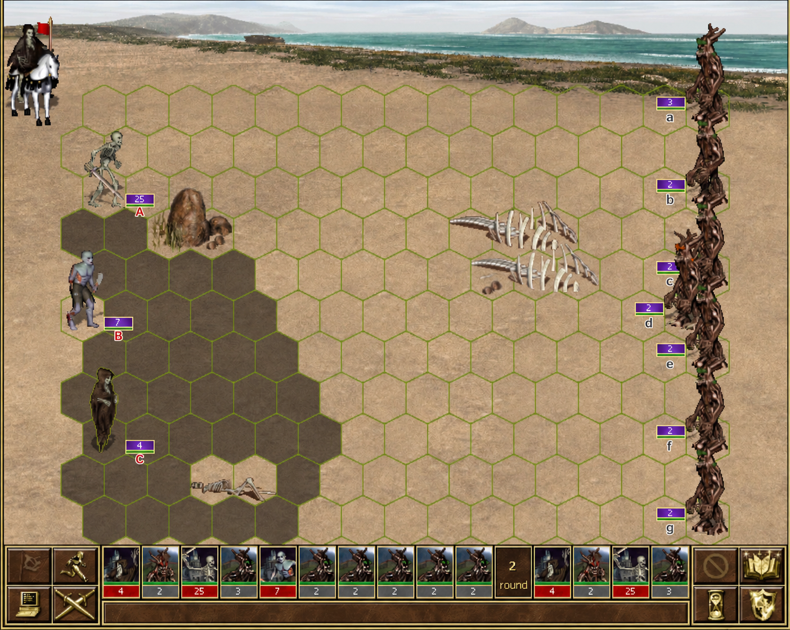

# `hip-0029` - Label every creature stack

> **Category:** Combat UI

Assign a stable, unique, single-character label to every `creature stack`: uppercase `A`–`T` for the attacking army and lowercase `a`–`t` for the defending army. Assign the next available label to every stack created during combat, including `Demons` summoned by `Pit Lords`, `Fangarms` raised by the `Horn of the Abyss` artifact, and `Elementals` summoned by `spells`. Annotate every `creature stack` with its label.

Render the label as part of the stack's battlefield presentation, not only in the **combat log**, a tooltip, or another secondary view.

Allow players to toggle the labels' persistent visibility. While the labels are hidden, holding `Alt` during combat temporarily reveals them.

Place it 2 pixels below the stack's hit-point bar and use a font two size steps smaller than the visible creature-count number. Color the letter using the controlling player's color, matching the color used for that stack in the battle queue. Use gray for neutral wandering monsters when there is no opposing hero. Add a white outline around the glyph so it remains legible against every battlefield background.

Use the same label wherever the stack is named. For example:

* “Jotunn Warlords (`C`) take a defensive stance and gain +25 `Defense Skill`.”
* “Trolls (`b`) regenerate 40 hit points.”
* “War Mammoths (`D`) reach `Rune Level 6`.”

> **Author:** Alexander Cyon · **Date:** 2026-10-10 · **Status:** **DRAFT** · **Estimate:** **Complex**
