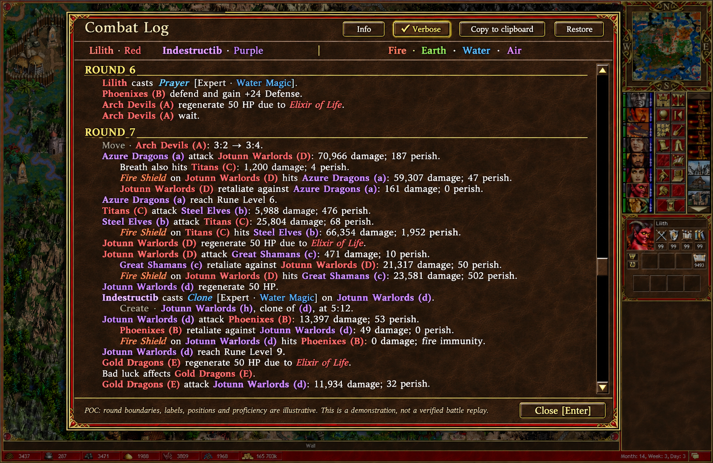

# `hip-0030` - Expand the combat log to full screen

> **Category:** Combat UI

Allow the **combat log** to expand across the full screen, even beyond the normal combat-window bounds. When reading the log, maximize the number of visible events.

## Proof of concept

This shared mockup combines the expanded layout with [stack labels](hip-0029.md), [player-colored stack names](hip-0031.md), [round grouping](hip-0032.md), [hero and artifact styling](hip-0033.md), [spell proficiency and school colors](hip-0034.md), [closing with `Enter`](hip-0035.md), [damage attribution](hip-0036.md), [regeneration sources](hip-0037.md), [hex coordinates](hip-0038.md), [additional battle events](hip-0039.md), [**Info / Verbose** controls](hip-0040.md), [thousands separators](hip-0044.md), and [clipboard copying](hip-0075.md).

The screenshot's primary damage figures are retained. Round boundaries, stack ownership and labels, spell proficiency, positions, and supplementary events are illustrative; the image demonstrates the proposed presentation rather than reconstructing the battle. `D` and `d` deliberately distinguish opposing `Jotunn Warlords` stacks. **Verbose** is selected to show movement and stack-creation examples.

[Original screenshot](assets/hip-0030-combat-log-reference.png) · [Image-generation prompt](assets/hip-0030-combat-log-poc-prompt.md)

> **Author:** Alexander Cyon · **Date:** 2026-10-10 · **Status:** **DRAFT** · **Estimate:** **Average**
